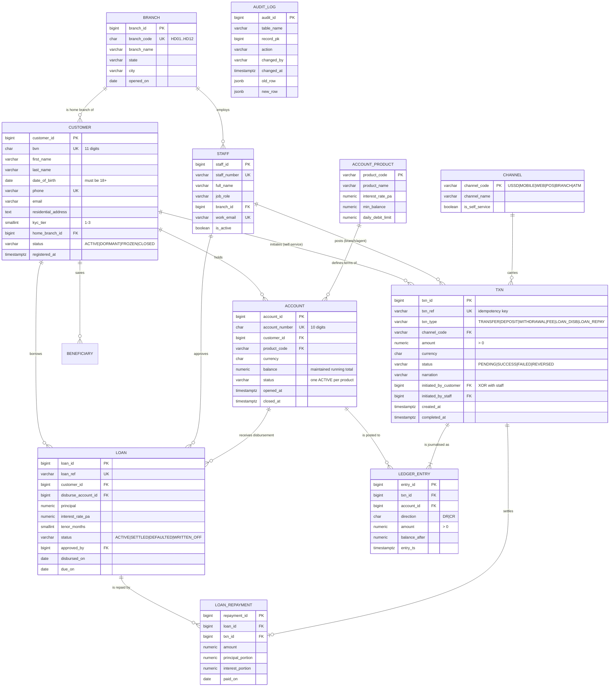

# Portfolio 1 — Entity Relationship Model

**Student:** Olaide Daniel (301911975) · Case study: Harmony Digital Microfinance Bank (HDMB)

The diagram is written in Mermaid, which GitHub renders natively — so the model
is version-controlled text that diffs across commits rather than a flat image
that silently goes stale. For the LMS upload, the rendered diagram is captured
as a screenshot from the GitHub view of this file (it can also be exported with
`npx @mermaid-js/mermaid-cli -i <this file> -o er.png`).

## 1. Conceptual / logical ER diagram

`AUDIT_LOG` is intentionally drawn without relationships: it is an append-only
sink written by a trigger and holds *soft* references (`table_name` + `record_pk`)
so it survives the deletion of the row it describes.

## 2. Cardinality and participation, stated

| Relationship | Reading |
|---|---|
| BRANCH → CUSTOMER | One branch is home to zero or many customers; every customer has exactly one home branch (mandatory). |
| CUSTOMER → ACCOUNT | A customer holds zero or many accounts; every account belongs to exactly one customer. At most one *ACTIVE* account per product. |
| TXN → LEDGER_ENTRY | **One-to-many, minimum two.** This is the critical cardinality: a transaction with one leg is money created out of nothing, and `trg_ledger_balanced` rejects it. |
| ACCOUNT → LEDGER_ENTRY | An account accumulates zero or many postings; entries are never updated or deleted, only offset by a reversal. |
| TXN → initiator | Exactly one of (customer, staff) — an exclusive-or relationship, enforced by `chk_txn_single_initiator` rather than by two optional foreign keys alone. |
| LOAN → LOAN_REPAYMENT | A loan has zero or many repayments; each repayment is also a `TXN`, so the cash and the credit record can never disagree. |

## 3. Why the transfer is not a single row

The obvious design is `transfer(from_account, to_account, amount)`. It was
rejected:

* A deposit has no sender and a withdrawal has no receiver, so both columns
  become nullable and the rule "one of them must be present" leaks into
  application code.
* A reversal has to either delete the row (destroying history) or add a negative
  amount (breaking `amount > 0`).
* There is no place to record what each account's balance *was*, so a disputed
  statement cannot be reconstructed.

Double entry solves all three: a deposit is DR till / CR customer, a reversal is
a new transaction with the legs swapped, and `balance_after` preserves the
account's position at the moment of posting.
